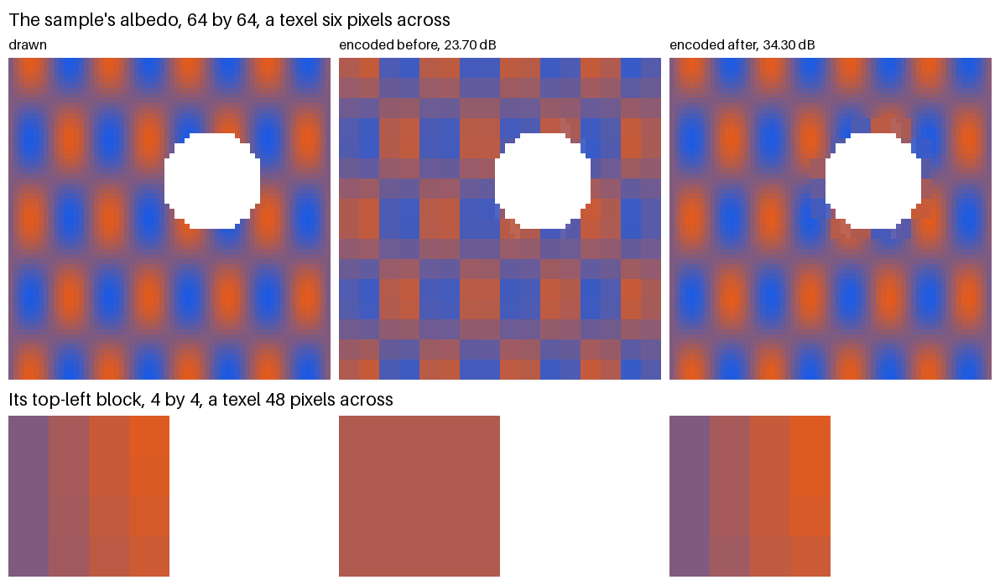
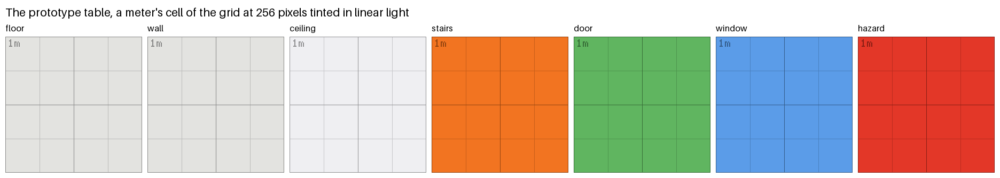
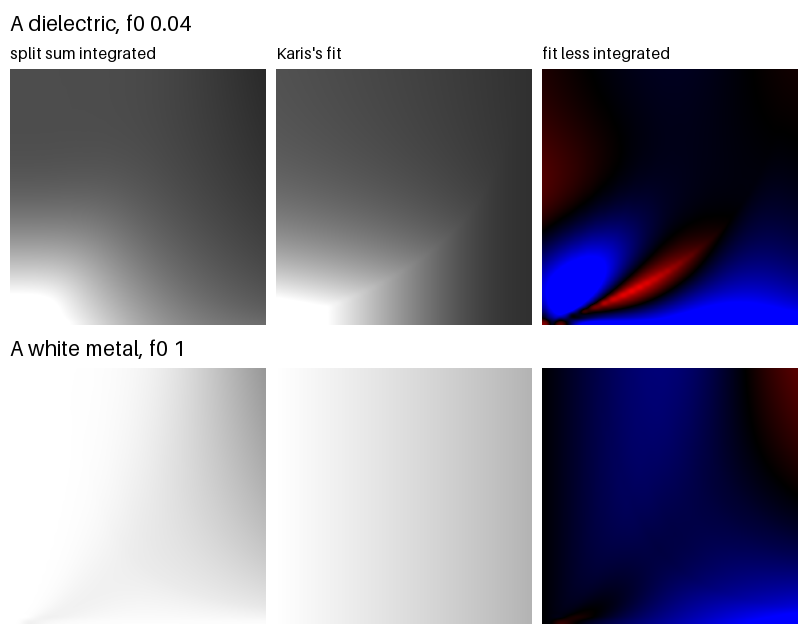
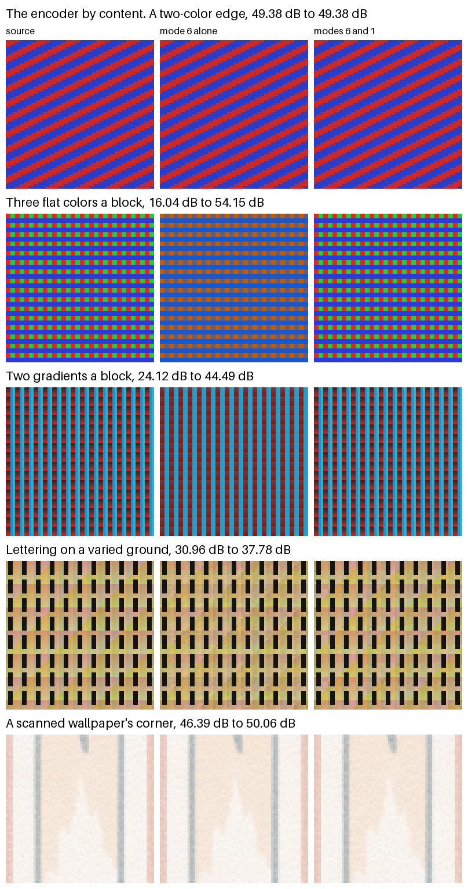

# Materials devlog

What landed in Materials, by day and newest first, with the pictures taken on the way, the captures
the repository keeps under `.github/assets` and the pictures made while an item was built, kept
under `.github/assets/readings` as WebP files named by their day, each on the day its name says, and
the notes written beside them as Markdown files named the same way. A line under Done names the item
of .github/REVIEW.md or .github/REVIEW-ARCHIVE.md and the commit that closed it.

## 2026-11-20

Commits that day

- `8760ae8` The module and the Tools module it takes are named by their repositories' new addresses
  in the link row, the README's submodule command and the submodule's address, and the tests take
  the Tools module at its latest pin.

## 2026-11-19

Commits that day

- `f6b99fe` The C# writer halves a side of any length by the box weights Pillow resamples with, so a
  picture of any size is written in the bytes the texture script writes.
- `f1c4a2c` The C# writer encodes BC5 of a picture's red and green and BC4 of its red as the texture
  script does, so a normal and a depth are made at run time in the bytes the build writes.

## 2026-11-18

The sample's ringed albedo as drawn, on the left, as the BC7 encoder wrote it with its power
iteration started at (1, 1, 1, 1), in the middle, each block flat at its mean and 23.70 dB over the
picture, and as it writes it started from the column of the channel that varies most, on the right,
34.30 dB, the whole picture above and its top-left block below, where Modeling's carpet holds at
45.27 dB and its wallpaper goes from 46.15 to 46.16.

The seven prototypes of the module's one table, a meter's cell of the grid at 256 pixels tinted in
linear light, floor, wall and ceiling one near white at sRGB 0.90, stairs orange, door green, window
blue and hazard red, over a grid whose face is 0.99, its lines 0.6 and its quarters' lines 0.82.

Karis's fit of the split sum against the split sum integrated by importance sampling, the share of
the light from all around a surface reflects toward the eye, roughness 0 to 1 across and the cosine
to the eye from 1 at the top to 0 at the bottom, a dielectric of f0 0.04 above and a white metal of
f0 1 below, the difference red where the fit is higher and blue where it is lower, full at 0.049
above and 0.415 below. The dielectric's largest difference is 0.084, at a roughness and a cosine of
0.12, and over the hits of rays arriving at random, whose cosine has a density of twice itself, its
mean is 0.0067 with 15.8% of the hits past 0.01. The metal's largest is 0.509, at a roughness of
0.99 seen at a cosine of 0.008, its mean over the hits 0.10 with 95.6% past 0.01, the fit holding
0.45 at a roughness of one where the integral worked by hand gives 0.3069 head on.

The BC7 encoder by content, each picture 64 by 64 texels at four pixels a texel, its source on the
left, mode 6 alone in the middle and modes 6 and 1 on the right, mode 1 tried for an opaque block
whose mode 6 error passes a mean of 4 a channel, 42 dB; a two-color edge holds at 49.38 dB both
ways, three flat colors a block go from 16.04 to 54.15 dB, two gradients a block from 24.12 to
44.49, lettering on a varied ground from 30.96 to 37.78 and a corner of Modeling's scanned wallpaper
from 46.39 to 50.06, at about 3 ms a block tried against 0.12 for mode 6 alone, Modeling's carpet
taking 0.93 ms a block for 46.40 dB where it took 0.12 for 45.27.

Commits that day

- `880743e` The C# writer encodes a block whose colors leave one line in BC7's modes 1 and 7 as the
  texture script does, its floating sums compensated as Python's are, so a whole carpet comes out
  the same bytes from both.
- `207d568` A picture whose sides are powers of two is written in C# as a KTX2 file of BC7 blocks in
  mode 6 with all its levels, the bytes the texture script writes for a tile whose blocks are mode
  6's.
- `7bd4dbc` A texture collection's manifest is read in C# to its entries, their pictures, sizes,
  means, leaf boxes and repeats, each standing for a material, so an engine draws what the texture
  script built without reading its JSON itself.
- `83dd8d1` The encoder bleeds a surface only where the leaves' cover stands in for its alpha, so a
  surface not cut out keeps its occlusion, roughness and metallic where it lets nothing through, and
  the README's one known limit is gone.
- `70679ed` The materials of a glTF file are read into descriptions at glTF's defaults with its
  emissive strength, index of refraction and diffuse transmission, an image an ORM texture packs
  held as one picture.
- `e170bf0` The encoder writes a block with alpha whose texels leave one line in BC7's mode 7 of two
  subsets, a drawn leaf atlas's visible color going from 32 to 44 dB, and the tests take the Tools
  module at its head.
- `fd8d83b` The tests take the Tools module at its head through its pin script, which finds no check
  new or changed, and the devlog lists each day's commits.
- `8c72f22` The encoder sums each color's moments once a block for mode 1's partition search, so a
  build of Modeling's collection takes 44 s where it took 94 and writes the same bytes, and the
  tests take the Tools module at its latest pin.
- `ac9652d` The encoder writes an opaque block whose colors leave one line in BC7's mode 1 of two
  subsets, three colors a block going from 16 to 54 dB and two gradients from 24 to 44, with a
  reading of the encoder by content.
- `3778350` A material is read from and written to a JSON file of its own beside its pictures, so a
  folder of materials stands without a glTF, and a description compares by its factors and its
  pictures.
- `5533cfb` The integrated split sum keeps its signature and its 1024 points, which a table kept
  elsewhere is held to, and a test holds four of its values so a change to it shows first here.
- `019c9f9` A material's means read a picture the module does not decode, as PNG or JPEG, through
  the engine's own decoding, which the README says owes rows from the top, straight alpha and the
  file's own numbers.
- `79eb411` A reading sets Karis's fit of the split sum against the split sum integrated by
  roughness and cosine for a dielectric and a metal, and a test holds the integration to the share
  worked by hand at a roughness of one.
- `68a0a93` A material's emitted light names its unit, candelas a square meter or glTF's unitless
  factor times its strength kept as it stands, which an engine scales by a convention of its own.
- `e63b5f7` The floor, the wall and the ceiling are one prototype color, the reading of the table is
  made again, and the tests take the Tools module's seven checks with the link row and the
  cheatsheet written as one word.
- `1257393` The module names no engine and describes no engine's form, its floors of roughness are
  named by the precision they keep, the prototype reading shows the one table, and the texture
  script writes a mean color averaged in linear light.
- `1522dc7` The module writes down how a lit surface sends its light back, the microfacet terms, the
  reflectance by the metallic and the split sum fitted and integrated, with both forms a probe's ray
  takes a surface in, and the README names the prototype table as the one both engines draw.
- `8ba288e` The module holds the prototype materials a level is blocked out with, one table of
  colors, the grid of a meter's cell and each picture as the level editor shows it, with a sheet of
  both engines' tables for the choice between them.
- `d3f2e37` The module describes a surface in glTF's terms with a dielectric's reflectance and its
  three forms, and works out a material's means in linear light over what its opacity covers through
  the one interface it asks of an engine, its files.
- `4f5f060` The module keeps its devlog, DEVLOG.md written by the Tools module's devlog script from
  the readings and the review, linked from the README's top and named with its command in AGENTS.md.
- `a5e2b6d` The tests take the checks every module keeps from the Tools submodule in place of their
  own copies, the library taking nothing of it, and a clone without the submodule stops with the
  command that fetches it.
- `7e69a59` The BC7 encoder starts its power iteration from the column of the channel that varies
  most, so a block whose red and blue move against each other keeps its gradient and the sample
  rises from 23.70 dB to 34.30, and the width test reads the scripts and project files as well.
- `6aeb83a` The module holds one texture encoder of the two the modules kept, writing Modeling's
  collection byte for byte and Vegetation's recipes with every opaque BC7 block decoding to an alpha
  of 255 and every level plain, and its tests read the sample it writes.
- `cb27a13` A test holds that no public type or member of the library and none of their
  documentation names either engine, the Vegetation module's test copied with this library's name.
- `1063064` The KTX2 reader refuses a level count past what the picture holds before it casts it,
  the decoder counts bytes in 64 bits and refuses a picture past what an array holds, and the tests
  read glTF's channels as numbers and BC7's rotations and pictures of uneven sizes against Pillow.
- `9f352ee` The tests run the README's binding word for word against a host that stands for an
  engine, with a GPU that samples BC7 and one that takes the decoded levels, and hold every public
  type named in the README.
- `0f2152b` The README tells a stranger how to bind the module in an engine of their own, which
  needs no interface implemented, the conventions it stands on and the smallest binding, with the
  two engines as examples of one.
- `6f93fe6` The module holds what each channel of a material's picture is for in glTF's terms with
  the color space that fixes, and reads a KTX2 file's levels, decoding BC1, BC4, BC5 and every mode
  of BC7 as Pillow's decoders do for 400 blocks.
- `f008dd9` A test reads the library's references and the packages they bring and fails where one is
  an engine, a window or a graphics API, the Tools module's test copied whole.
- `f5ab282` The library builds as the assembly 3DEngine.Materials under that package id and its
  tests as 3DEngine.Materials.Tests, the namespaces staying Materials, and the review gains the
  first Reply on what the module holds and leaves.
- `2f6de5b` The module gains its solution, an empty library whose public members need summaries, a
  test that it loads and one that holds comment lines to 100 columns, the version at 0.1 and a build
  workflow on Linux, Windows and macOS, and STYLE.md gains the rules on the middle dot and on a
  comment line's width.
- `d201e1c` The module gains its documents, AGENTS.md, the README, STYLE.md, COMMITS.md and the code
  of conduct as the other modules keep them, with git's ignore and attribute files, the review and
  the norm.
